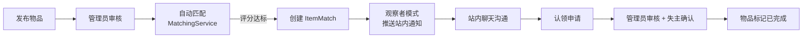

# 校园失物招领系统

<div align="center">


</div>

[简体中文](#-项目简介) | [English](#-english)

一个用 Spring Boot 写的校园失物招领平台。失主发"失物启事"，捡到东西的同学发"拾获启事"，物品过审后系统自动把两边对上，之后走聊天、认领申请、审核、确认的流程把东西还回去。

项目最初的动机是把课程里学的分层架构和设计模式真正落到一个完整的 Web 应用里，而不是停留在 UML 图上。目前系统能完整跑通从发布到归还的全流程。

---

## 📖 项目简介

### 它解决了什么问题

校园里丢东西的典型流程是：发朋友圈 / 求助群里 → 没人理 → 放弃。这个系统把这个过程结构化了：

- **信息集中**：所有失物 / 拾获信息进同一个池子，可搜索、可浏览；
- **自动配对**：新物品过审后立刻和历史物品做相似度匹配，命中就直接建对并通知双方，不需要人肉翻帖子碰运气；
- **归还可追溯**：匹配不等于归还，认领要走"申请 → 管理员审核 → 失主确认"两道验证，避免有人瞎认领。

### 整体流程



---

## ✨ 功能特性

**用户与权限**
- 注册 / 登录走 Spring Security 表单认证，密码 BCrypt 加密存储；
- 两种角色：普通用户和管理员，接口层用 `hasRole("ADMIN")` 做方法级控制。未登录可浏览首页、搜索和物品详情，发布、聊天、认领等操作要求登录。

**物品管理**
- 失物 / 拾获两种类型，支持多图上传（单文件上限 10MB，存本地 `uploads/` 目录）；
- 物品带两级位置信息（地点 + 详细地点）、分类、以及一个用于匹配的"总权重"字段；
- 状态机：`待审核 → 待认领 → 已认领 → 已完成`，状态流转由认领流程驱动，不暴露手动改状态的口子。

**智能匹配**
- 候选集先做硬性预筛：类型必须相反（失物对拾获）、总权重相同、地点相同、且已过审——不满足的直接不进评分；
- 通过预筛的候选再算加权相似度（见下文），≥ 0.7 落库为 `ItemMatch`；
- 同一对物品有唯一性约束（`existsMatchBetweenItems`），重复发布不会产生重复配对。

**认领与沟通**
- 认领人提交验证信息（比如描述物品里的细节），管理员先审一道；
- 管理员通过后**还要失主确认**，这是故意设计的双保险——管理员只能判断材料齐不齐，只有失主能判断"这是不是我的东西"；
- 聊天按物品维度开线程（`ChatThread`），同两个用户对同一件物品只会有一条线程，带未读计数。

**通知与管理后台**
- 匹配成功、认领进度变化、审核结果等事件都会生成站内通知；
- 管理后台覆盖：数据统计看板、用户管理、物品审核、认领审核、举报处理、公告管理。

---

## 🎯 匹配机制（核心）

匹配逻辑集中在 `MatchingService`，是整个项目里最值得看的一段代码。

### 评分函数

```java
private double calculateMatchScore(Item item1, Item item2) {
    double score = 0.0;
    // 总权重一致 +0.4 —— 物品登记时称重/估重得到的字段
    if (item1.getTotalWeight().equals(item2.getTotalWeight())) score += 0.4;
    // 一级地点一致 +0.3 —— 比如"教学楼""图书馆"
    if (item1.getLocation().equals(item2.getLocation())) score += 0.3;
    // 二级详细地点一致 +0.2 —— 比如"三楼东侧自习区"
    if (item1.getDetailedLocation() != null && item2.getDetailedLocation() != null
            && item1.getDetailedLocation().equals(item2.getDetailedLocation())) score += 0.2;
    // 类别一致 +0.1
    if (item1.getCategory().equals(item2.getCategory())) score += 0.1;
    return score;
}
```

权重分配的考虑：失物招领场景里"丢在哪"比"是什么"更稀缺——同一天在教学楼丢一张校园卡的人可能有很多，但丢失地点是一个强区分信号，所以地点两项合计占 50%。权重 0.4 看似很高，但它是匹配的**前置条件**（预筛阶段就要求相等），评分里它更多是兜底。

### 为什么用观察者模式

匹配产生后要做的事不止一件：存库、生成通知、以后可能还要发邮件或接入站内信。如果都写在 `findAndCreateMatches` 里，每加一种通知渠道就要改一次核心逻辑。

所以 `MatchingService` 实现了 `ItemMatchSubject` 接口，用 `CopyOnWriteArrayList` 维护观察者列表，匹配的创建 / 更新 / 取消三种事件各自广播。目前注册的观察者是 `NotificationObserver`（生成站内通知）。这样匹配规则怎么改都不影响通知逻辑，反过来也一样。

选 `CopyOnWriteArrayList` 而不是普通 `ArrayList`，是因为观察者在运行期可能动态增删，而遍历通知的频率远高于修改频率，写时复制的代价可以忽略，还能免掉遍历时的并发问题。

### 已知的取舍

- 评分基于精确相等比较，没有做模糊匹配（比如"水杯"和"保温杯"不会互相命中），这在分类体系足够细的前提下是可接受的，后续可以考虑对标题和描述做文本相似度；
- 阈值 0.7 硬编码在服务里，如果需要可以抽成配置项（`application.yml` 里已经预留了 `app.matching.similarity-threshold`）。

---

## 🛠️ 技术栈

| 层次 | 选型 | 说明 |
|------|------|------|
| 框架 | Spring Boot 3.1.5 / Java 17 | 单体应用，未拆微服务——这个规模没有拆的必要 |
| 安全 | Spring Security 6 | 表单登录 + 自定义成功跳转 + 方法级权限 |
| 持久层 | Spring Data JPA (Hibernate) | `ddl-auto: update`，实体即表结构 |
| 数据库 | H2（文件模式） | 免安装，`data/` 目录即整个数据库 |
| 视图 | Thymeleaf 3.1.2 + Bootstrap 5 | 服务端渲染，配 thymeleaf-extras-springsecurity6 做页面级权限显隐 |
| 工具 | Lombok / Commons FileUpload / Validation | — |

模板共 30+ 个页面，覆盖用户端全部流程和管理后台。

---

## 🚀 快速开始

环境要求：JDK 17+，Maven 3.6+。

```bash
git clone https://github.com/zzuli-ljz/zzuli-ljz.github.io.git
cd zzuli-ljz.github.io
mvn spring-boot:run
```

首次启动时 `DataInitializer` 会检测到空库，自动创建测试账号、示例物品和若干匹配记录；之后再启动会跳过初始化，数据持久化在 `data/lostfounddb` 文件里。想重置数据，删掉 `data/` 目录重启即可。

启动后访问 **http://localhost:8081/campus-lost-found/**（端口和 context path 都在 `application.yml`）。

默认测试账号：

| 角色 | 用户名 | 密码 |
|------|--------|------|
| 管理员 | `admin` | `admin123` |
| 普通用户 | `user` / `lisi` / `wangwu` / `zhaoliu` | 均为 `user123` |

调试数据库可以开 H2 控制台：`http://localhost:8081/campus-lost-found/h2-console`，JDBC URL 填 `jdbc:h2:file:./data/lostfounddb`，用户名 `sa`，密码留空。

---

## 📂 项目结构

```
src/main/java/com/campus/lostfound/
├── CampusLostFoundApplication.java
├── config/        # SecurityConfig、DataInitializer、观察者装配
├── controller/    # Item / Match / Claim / Chat / Notification / Admin ...
├── service/       # MatchingService、ClaimService、ChatService 等业务逻辑
├── observer/      # ItemMatchSubject / ItemMatchObserver / NotificationObserver
├── entity/        # User、Item、ItemMatch、Claim、ChatThread 等 JPA 实体
├── repository/    # Spring Data JPA 接口
└── dto/

src/main/resources/
├── application.yml
├── templates/     # Thymeleaf 页面（30+）
└── static/        # CSS / JS / 图片资源
```

---

## 🌍 English

### Overview

A campus lost & found platform built with Spring Boot 3.1.5 and Java 17. Students post **lost** or **found** notices; once a post passes moderation, the system automatically cross-matches it against historical posts, and matched pairs go through in-site chat, a claim application, admin review, and a final owner confirmation before an item is marked resolved.

The project was started to put layered architecture and GoF design patterns into practice in a complete, runnable web application rather than stopping at UML diagrams.

### Key features

- **Auto matching** — the core of the system. Candidates are pre-filtered by hard constraints (opposite post type, equal item weight, same location, approved status), then scored by a weighted similarity function: item weight 0.4 + location 0.3 + detailed location 0.2 + category 0.1. Pairs scoring ≥ 0.7 are persisted as `ItemMatch` records, with uniqueness checks to prevent duplicates.
- **Observer pattern** — `MatchingService` acts as the subject (`ItemMatchSubject`), keeping observers in a `CopyOnWriteArrayList` and broadcasting match-created / updated / cancelled events. `NotificationObserver` turns these events into in-app notifications, keeping matching logic fully decoupled from notification channels.
- **Two-step claim verification** — a claim must pass admin review *and* owner confirmation. The admin can only judge whether the submitted evidence looks plausible; only the true owner can confirm identity of the item. This intentionally redundant step prevents false claims.
- **Item lifecycle as a state machine** — `PENDING_APPROVAL → PENDING_CLAIM → CLAIMED → COMPLETED`, transitions driven exclusively by the claim workflow.
- **Per-item chat threads** — one `ChatThread` per (item, user pair) with unread counts.
- **Role-based access** — Spring Security form login with BCrypt; public browsing, authenticated posting/chat, and `ADMIN`-only backend (dashboards, user management, moderation, reports, announcements).

### Getting started

Requires JDK 17+ and Maven 3.6+.

```bash
git clone https://github.com/zzuli-ljz/zzuli-ljz.github.io.git
cd zzuli-ljz.github.io
mvn spring-boot:run
```

On first launch, `DataInitializer` seeds demo accounts, items and match records into the embedded H2 database (stored under `data/`). Delete the folder to reset.

Open **http://localhost:8081/campus-lost-found/**

| Role | Username | Password |
|------|----------|----------|
| Admin | `admin` | `admin123` |
| User | `user` / `lisi` / `wangwu` / `zhaoliu` | `user123` |

### Design notes

Location carries a combined weight of 0.5 in the scoring function because in a campus setting, *where* an item was lost is a far stronger discriminator than *what* it was — many people may lose a campus card on the same day, but rarely at the exact same spot. Exact-equality scoring (no fuzzy text matching) is a known trade-off, acceptable given the fine-grained category and two-level location taxonomy; a title/description similarity pass is a natural next step.

---

## 📝 备注

- H2 只适合开发演示，换 MySQL 只需要改 `application.yml` 的 datasource 和依赖；
- 匹配阈值与权重想调整的话，改 `MatchingService#calculateMatchScore` 一处即可；
- 仓库里 `data/` 下带着一份初始化好的测试库，克隆后直接启动就能看到示例数据效果。
